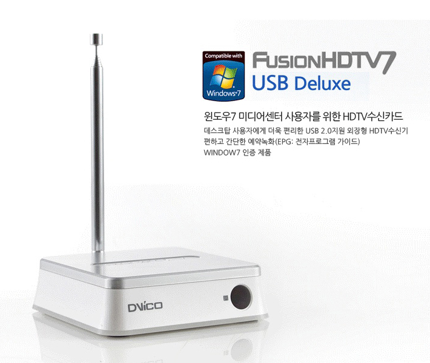

# DViCO FusionHDTV7 USB Deluxe 리눅스 드라이버

<p align="center"></p>

DViCO **FusionHDTV7 USB Deluxe**(USB `0fe9:d620`) ATSC 수신기를 Ubuntu 26.04(커널 7.0)에서 쓰기 위한 수정 드라이버입니다.
제조사는 Windows 드라이버만 제공하지만, 이 장치는 리눅스 커널의 `au0828` 드라이버가 이미 알고 있는 장치입니다.
다만 커널 드라이버의 버그 때문에 `/dev/dvb/adapter0`는 생기는데 **열 수가 없어서** 실제로는 쓸 수 없었습니다.
이 저장소는 그 버그를 고친 `au0828` 모듈을 DKMS로 설치합니다.

> *English summary:* The in-kernel `au0828` driver binds the DViCO FusionHDTV7 USB (`0fe9:d620`, AU0828 + AU8522 + XC5000)
> but opening the DVB frontend fails with `Tuner is busy. Error -19`. This board has no analog inputs, so no tuner media
> entity is ever registered, and `au0828_enable_source()` returns `-ENODEV` when it cannot find a tuner→demod link.
> This repo ships the linuxtv media-tree `au0828` with a one-hunk fix ([patch](patches/au0828-dvb-only-tuner.patch)) as a DKMS module.

## 상태

| 기능 | 상태 |
|---|---|
| 장치 인식, `/dev/dvb/adapter0` (frontend, demux, dvr) | 동작 확인 |
| ATSC 8-VSB 수신 | 동작 확인 (2026-10-19, 사내 공청망 CATV ch16 135 MHz, ch17 141 MHz 영상 디코딩) |
| QAM (J.83B 케이블) | 미검증 — 커널 `au8522` 경로는 그대로 |
| 아날로그 / 리모컨 | 이 보드는 커널에서도 아날로그 입력 정의가 없음 |

## 하드웨어

| 부품 | 칩 | I2C (7-bit) | 리눅스 드라이버 |
|---|---|---|---|
| USB 브리지 | Auvitek AU0828 | — | `au0828` (**이 저장소에서 수정**) |
| ATSC/QAM 복조기 | Auvitek AU8522 | 0x47 | `au8522_dig` (커널 기본) |
| 튜너 | Xceive XC5000 | 0x61 | `xc5000` (커널 기본) |

- 튜너 펌웨어 `dvb-fe-xc5000-1.6.114.fw`는 `linux-firmware` 패키지에 들어 있고, 처음 튜닝할 때 올라갑니다.
- USB 인터페이스 1, 2는 USB 오디오 클래스라 `snd-usb-audio`가 잡습니다(카드 이름 `USB Device 0xfe9:0xd620`). DVB 수신에는 쓰이지 않습니다.

## 원인

커널 `au0828`는 아날로그(V4L2)·ALSA·DVB가 튜너 하나를 나눠 쓰도록 media controller로 소유권을 관리합니다.
DVB 프론트엔드를 열면 `dvb_frontend_open()` → `au0828_enable_source()`가 불려서, 미디어 그래프에서
**튜너 엔티티 → 복조기** 링크를 찾아 활성화합니다.

그런데 이 보드(`AU0828_BOARD_DVICO_FUSIONHDTV7`)는 카드 정의에 아날로그 입력이 없어서 V4L2 쪽이 등록되지 않고,
따라서 튜너 엔티티(`MEDIA_ENT_F_TUNER`)가 아예 만들어지지 않습니다. `dev->tuner`가 NULL이니 링크를 못 찾고 `-ENODEV`를 돌려줍니다.

```
$ media-ctl -d /dev/media0 -p        # 튜너 엔티티 없이 AU8522 → dvb-demux 만 있음
$ tsp -I dvb --adapter 0 ...
* Error: dvb: error opening /dev/dvb/adapter0/frontend0: No such device
$ dmesg
usb 1-9: Tuner is busy. Error -19
```

아날로그 입력이 없는 au0828 보드는 이 제품뿐이라 지금까지 드러나지 않은 것으로 보입니다. 2026-10-19 기준 linuxtv media 트리에도 그대로 있습니다.

### 수정
튜너 엔티티가 없으면 나눠 쓸 상대도 없으므로, DVB가 바로 튜너를 쓰게 합니다([patches/au0828-dvb-only-tuner.patch](patches/au0828-dvb-only-tuner.patch)).

```c
	if (entity->function == MEDIA_ENT_F_DTV_DEMOD) {
		if (!dev->tuner) {
			ret = 0;
			goto end;
		}
		...
```
`au0828_disable_source()`는 활성 링크가 없으면 바로 돌아가므로 닫을 때 따로 고칠 것이 없습니다.

## 설치

Ubuntu 26.04, 커널 `7.0.0-26260609-generic`(b-rad `kernel+mediatree+hauppauge` PPA)에서 확인했습니다.

### 1. 패키지
```sh
sudo apt-get install -y build-essential linux-headers-$(uname -r) dkms dvb-tools linux-firmware
# 선택: TSDuck (https://tsduck.io)
```

### 2. 드라이버 (DKMS)
```sh
sudo ./install.sh
```
`install.sh`가 하는 일:
1. `driver/`를 `/usr/src/au0828-fusionhdtv7-1.0/`에 복사하고 `dkms add` / `dkms install`
   → `/lib/modules/$(uname -r)/updates/dkms/au0828.ko.zst` (커널 기본 모듈보다 우선)
2. 실행 중인 `au0828`를 내리고(`modprobe -r`) 수정 모듈을 다시 올림

DVB 프로그램이 장치를 열고 있으면 2단계가 실패합니다. 프로그램을 닫고 다시 실행하거나 USB를 다시 꽂으세요.

- **한 번만 실행하면 됩니다.** 재부팅해도 유지되고, `AUTOINSTALL=yes`라 새 커널을 설치하면 DKMS가 자동으로 다시 빌드합니다(해당 `linux-headers` 필요).
- 이미 설치되어 있던 다른 커널로 부팅할 경우 한 번 빌드: `sudo dkms install au0828-fusionhdtv7/1.0 -k <커널 버전>`
- OS를 새로 설치했다면 `sudo ./install.sh`를 다시 실행합니다.
- 제거(커널 기본 모듈로 복귀): `sudo dkms remove au0828-fusionhdtv7/1.0 --all`

### 3. 확인
```sh
cat /sys/module/au0828/srcversion; modinfo -F srcversion au0828   # 둘이 같으면 수정 모듈이 로드된 것
modinfo -n au0828                                                  # .../updates/dkms/au0828.ko.zst
sudo dmesg | grep -iE "au0828|au8522|xc5000"
#  au0828: Registered device AU0828 [DViCO FusionHDTV USB]
#  usb 1-9: DVB: registering adapter 0 frontend 0 (Auvitek AU8522 QAM/8VSB Frontend)...
#  xc5000: Firmware dvb-fe-xc5000-1.6.114.fw loaded and running.     <- 첫 튜닝 시
ls /dev/dvb/adapter0          # demux0 dvr0 frontend0 net0
```
`/dev/dvb`는 `root:video` 권한이므로 사용자 계정을 `video` 그룹에 넣으면 sudo 없이 쓸 수 있습니다(`sudo usermod -aG video $USER`).

## 사용

```sh
# 채널 스캔 (한국 VHF/UHF 6 MHz 채널표)
dvbv5-scan -a 0 -o channels.conf tools/kr-atsc-scan.conf
dvbv5-zap  -a 0 -c channels.conf -P -o out.ts -t 30 KBS1

# TSDuck: 지상파 ch15 (479 MHz) 30초 녹화
tsp -I dvb --adapter 0 --delivery-system ATSC --frequency 479000000 --modulation 8-VSB \
    -P until --seconds 30 -P analyze -o an.txt -O file rec.ts
```

## 문제 해결

| 증상 | 확인 |
|---|---|
| `No such device`, dmesg `Tuner is busy. Error -19` | 커널 기본 `au0828`가 로드됨. `modinfo -n au0828`, `dkms status`로 수정 모듈 설치 확인 |
| `Device or resource busy` | 다른 프로그램이 프론트엔드를 열고 있음 (한 번에 하나만 가능). `sudo fuser -v /dev/dvb/adapter0/*` |
| 커널 업데이트 후 다시 `Tuner is busy` | 새 커널용 DKMS 빌드 확인: `dkms status` |
| Secure Boot 시스템에서 로드 거부 | 모듈을 MOK 키로 서명해야 함 (`mokutil --sb-state`) |

## 저장소 구성

```
driver/      au0828 전체 소스 (linuxtv media 트리 기준) + 수정, Makefile, dkms.conf,
             au8522.h · xc5000.h · tda18271.h · mxl5007t.h (커널 내부 헤더 사본)
patches/     au0828-dvb-only-tuner.patch (수정 부분만, 커널 트리 기준 경로)
install.sh   DKMS 설치 + 모듈 교체
tools/       kr-atsc-scan.conf (dvbv5-scan용 한국 VHF/UHF 채널표)
docs/images/ 제품 사진
```

`driver/`는 [linuxtv media 트리](https://git.linuxtv.org/media.git/tree/drivers/media/usb/au0828)의 au0828이고,
이 커널의 기본 모듈과 같은 계열입니다(HVR1265, Impact VCB-e 지원 포함). 고친 곳은 `au0828-core.c`의 `au0828_enable_source()` 한 군데입니다.

## 관련

- [sendust/skytv_hdusbmini](https://github.com/sendust/skytv_hdusbmini): 커널이 지원하지 않는 SKYTV HD USB mini용 드라이버를 새로 만든 프로젝트

## 라이선스

- 드라이버 소스는 리눅스 커널과 같은 **GPL-2.0**입니다([COPYING](COPYING)).
- `docs/images/hdtv7deluxe_usb.png`는 제품 사진입니다.
- 제조사와 관계없는 비공식 드라이버입니다. 사용에 따른 책임은 사용자에게 있습니다.
